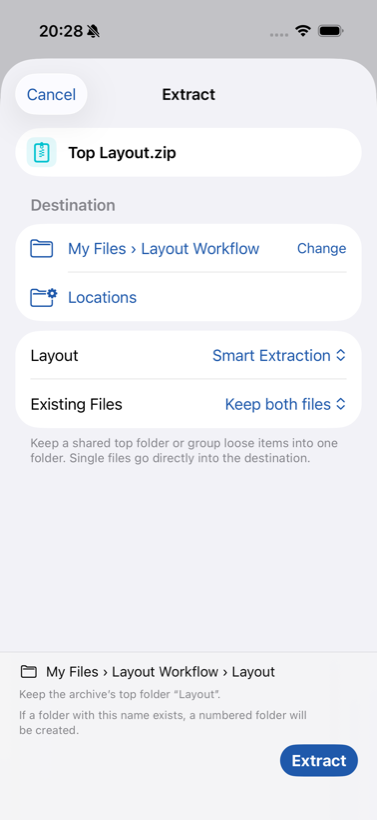
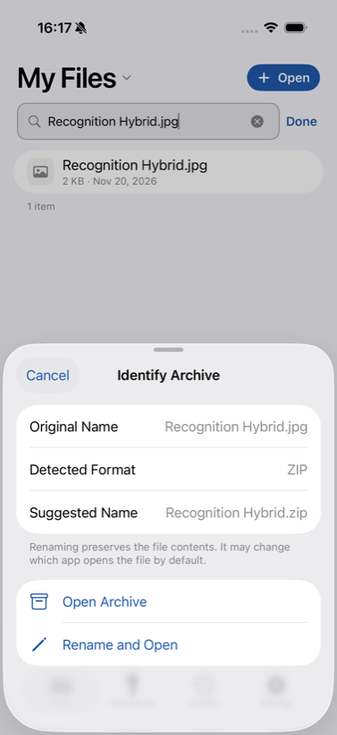

<p align="center">
  
</p>

<h1 align="center">AetherUnzip</h1>

<p align="center"><strong>English</strong> · <a href="README.zh-CN.md">简体中文</a></p>

<p align="center">A native archive extractor and file manager for Mac, iPhone, and iPad<br>Available in English, Simplified Chinese, and Japanese</p>

<p align="center">
  macOS 14+ · iOS 17+ · iPadOS 17+ · <a href="LICENSE">GPL-3.0-only</a> · <a href="PRIVACY.md#english">Privacy Policy</a>
</p>

<p align="center">
  <a href="#features">Features</a> ·
  <a href="#quick-start">Quick Start</a> ·
  <a href="#tested-formats">Tested Formats</a> ·
  <a href="#contributing">Contributing</a>
</p>

## Features

| Smart Extraction | Archive Identification |
| :---: | :---: |
|  |  |
| See the output path before you extract. Smart Extraction keeps an existing top-level folder or groups loose files into a new one. | Identify archives by their contents from the context menu. AetherUnzip can open a valid ZIP appended to a viewable JPEG. |

- **File management and previews.** Browse folders you have granted access to. Search, sort, copy, move, or edit files. Browse archive folders, open nested archives, and preview common documents and images with Quick Look. If a file is too large to preview, you can extract it on its own.
- **Batch extraction and retries.** Choose one destination and conflict policy for the batch. Open the output folder for any successful archive, or retry a failed archive on its own and enter a password if needed.
- **Password library.** Store passwords in the system Keychain. A remembered password remains associated with its archive after a rename. During extraction, choose a saved password or try the entire library. The driver documentation covers Chinese password encodings for ZIP. [Archive drivers](docs/drivers.md)
- **Cache controls.** Check disk usage, clear unused previews, and set separate limits for single-file previews and nested archive staging.

## Quick Start

Get the source from this repository and run the commands below from the repository root. The app calls the same Core as the CLI through the Swift SDK. Core builds independently on macOS and Linux and exposes a C ABI for integration into other programs.

### Apple App and Swift SDK

On macOS, install Xcode 16 or later with Swift 6 and CMake 3.24 or later. The app runs on **macOS 14+, iOS 17+, and iPadOS 17+**.

```sh
./scripts/build-apple.sh
swift test --package-path bindings/swift
open apps/AetherUnzip/AetherUnzip.xcodeproj
```

In Xcode, select the **AetherUnzip** scheme and run it on a Mac or an iPhone or iPad simulator. To install on a physical device, configure a development team and signing. The build script generates the local XCFramework used by the app and SDK. See the integration guide for command-line builds, signing, and UI tests. [Apple integration guide](docs/apple-integration.md)

### Core and CLI

You need CMake 3.24+, a C17/C++17 toolchain, `patch`, and the zlib and bzip2 development libraries. On macOS, the Apple SDK provides the system libraries. On Ubuntu 24.04, install the dependencies below. The system OpenSSL 3 Crypto library handles encrypted archives.

```sh
sudo apt-get update
sudo apt-get install -y build-essential cmake patch zlib1g-dev libbz2-dev libssl-dev
```

Build Core and run CTest on macOS or Linux. The first configuration downloads dependency sources and checks their SHA-256 hashes.

```sh
cmake -S . -B build/core -DCMAKE_BUILD_TYPE=Release
cmake --build build/core --parallel
ctest --test-dir build/core --output-on-failure
```

## Extraction Layouts

Use the system folder picker to choose a destination, or switch to the archive's folder if you have granted access, or to App Documents. The expected output path appears next to the confirmation button.

| Layout | Where files go |
| --- | --- |
| Smart Extraction (default) | Keeps a single top-level folder. Groups multiple top-level items into a folder named after the archive. Writes a single file directly to the destination. |
| Extract Directly | Writes into the destination and preserves the archive's directory structure. |
| Separate Folder | Creates a folder named after the archive and preserves the directory structure inside it. |
| Remove Top Folder | When all selected items share a top-level folder, extracts that folder's contents directly to the destination. |

New output folders get a numeric suffix when a name is already taken. For file conflicts, AetherUnzip keeps both versions by default. You can also skip, stop, or replace.

## Tested Formats

| Format | Tested coverage |
| --- | --- |
| ZIP / ZIP64 | Deflate, empty archives, UTF-8 paths, ZipCrypto, WinZip AES-256, disk-numbered volumes, and ZIP with a prepended payload |
| 7z | LZMA2 and AES-256, including solid archives and encrypted filenames |
| RAR / RAR5 | Single volumes, files spanning multiple volumes, and solid multi-volume samples. Single-volume RAR5 supports AES-256 content and filename encryption, including solid archives. |
| TAR | USTAR |
| CAB | Single-volume MSZIP and LZX |
| ISO 9660 | Standard volume descriptors and Rock Ridge |
| LHA / LZH | LH7 |
| GZIP, LZ4, Zstandard, XZ, BZIP2 | Standalone compressed streams and TAR combinations |
| Brotli | Standalone `.br` streams |
| XP3 | Standard KiriKiri containers, raw or zlib indexes, mixed segments, and Adler-32 verification |

Select all parts of a multi-volume archive together in the file picker. Supported naming includes `name.7z.001`, `name.zip.001`, `name.z01` with a final `name.zip`, `name.part1.rar`, and `name.rar` with `name.r00`. Format profiles can open wrapper files with a fixed signature and offset. In the app, **Settings → About → Extraction Support** lists the capabilities of the current build. [Archive drivers](docs/drivers.md) · [Format profiles](docs/format-profiles.md)

## CLI Verification Examples

Use the CLI to verify detection, decoding, and extracted files independently of the app. These commands use fixtures supplied with the repository.

```sh
build/core/aether-unzip --probe tests/fixtures/sample.tar.gz
build/core/aether-unzip tests/fixtures/sample.zip
build/core/aether-unzip --ls tests/fixtures/sample.zip docs
build/core/aether-unzip --cat tests/fixtures/sample.zip docs/readme.txt
build/core/aether-unzip --verify tests/fixtures/sample.zip
output="$(mktemp -d "$PWD/build/sample-output.XXXXXX")"
build/core/aether-unzip tests/fixtures/sample.zip "$output"
```

`--verify` streams regular files through the driver's integrity checks and reports the file and byte counts. The first column of a listing is the zero-based entry index. Repeat `--entry INDEX` in ascending order to select entries for verification or extraction. Use `--max-total-bytes N` to test the decoding budget. Run `aether-unzip --help` for all options. Exit codes are 0 for success, 1 for failure, and 2 for incorrect usage.

```sh
# Verify the third entry in a solid RAR5 archive with the public fixture password
printf '%s\n' fixture-pass | build/core/aether-unzip --verify --entry 2 --password-stdin \
  tests/fixtures/rar5-aes-solid-header.rar

build/core/aether-unzip --verify \
  --volume tests/fixtures/volumes/sample.7z.002 \
  --volume tests/fixtures/volumes/sample.7z.003 \
  tests/fixtures/volumes/sample.7z.001

ctest --test-dir build/core -R '^cli[.]verify$' --output-on-failure
```

`--password-stdin` reads one UTF-8 line from standard input. Pass the first volume as the main archive path and add the remaining volumes in order with `--volume`. For disk-numbered ZIP, begin with `.z01` and finish with `.zip`. When extracting, `--strip-root Layout` removes the shared top-level folder named `Layout`, and `--keep-both` adds a numeric suffix to an incoming file when its name is already taken.

## Contributing

When reporting an issue, include the OS version, app or CLI version, archive format, and steps to reproduce. For archive-specific issues, share a minimal sample that can be made public and describe the expected output. In pull requests, explain what changed and which checks you ran. For new formats, include a fixture with a documented source and update the supported capabilities. [Test fixtures](tests/fixtures/README.md)

| Developer resources | What they cover |
| --- | --- |
| [Project spec](docs/spec.md) · [Development and commit guidelines](AGENTS.md) | Platforms, acceptance criteria, and verification by layer |
| [Architecture](docs/architecture.md) · [Roadmap](docs/roadmap.md) | How the app, Swift SDK, Core, and drivers fit together |
| [C ABI](docs/api.md) · [Security](docs/security.md) | Integration, object lifetimes, resource budgets, and safe extraction |
| [Apple integration](docs/apple-integration.md) · [CI configuration](.github/workflows/ci.yml) | Build, signing, and test commands |
| [Dependencies and notices](third_party/README.md) | Dependency versions, enabled features, and third-party licenses |

## License

Copyright © 2026 AetherUnzip contributors.

The app, Swift SDK, Core, and CLI are licensed under the GNU General Public License v3.0 only (GPL-3.0-only). When distributing binaries, provide the Corresponding Source as required by Section 6. Third-party components and the separately marked libarchive AES helpers retain their own licenses. [License](LICENSE) · [Third-party notices](third_party/README.md)
