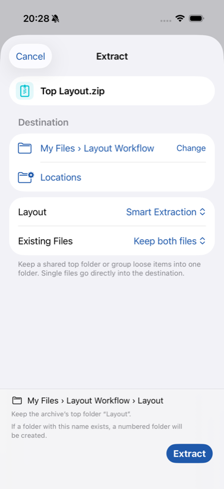
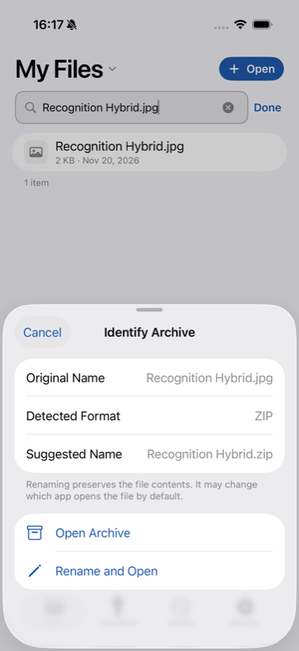

<p align="center">
  
</p>

<h1 align="center">AetherUnzip · 以太解压</h1>

<p align="center"><a href="README.md">English</a> · <strong>简体中文</strong></p>

<p align="center">面向 Mac、iPhone 和 iPad 的原生解压工具<br>支持简体中文、English、日本語</p>

<p align="center">
  macOS 14+ · iOS 17+ · iPadOS 17+ · <a href="LICENSE">GPL-3.0-only</a> · <a href="PRIVACY.md#简体中文">隐私政策</a>
</p>

<p align="center">
  <a href="#功能一览">功能一览</a> ·
  <a href="#快速开始">快速开始</a> ·
  <a href="#已验证格式">已验证格式</a> ·
  <a href="#参与贡献">参与贡献</a>
</p>

## 功能一览

| 智能解压 | 按内容识别 |
| :---: | :---: |
|  |  |
| 确认前看清目标位置。保留已有顶层目录，或给散落的文件建一个文件夹。 | 长按或右键识别实际格式。即使 ZIP 附在可正常打开的 JPEG 后面，也能识别并打开。 |

- **文件管理与预览** 浏览系统授权目录，搜索、排序、复制、移动或编辑文件。归档内可按目录浏览、进入嵌套包，或用 Quick Look 查看常见文档和图片。超出预览上限时，可以直接解压该文件。
- **ZIP 压缩** 长按或右键文件、文件夹，或多选后打开操作菜单，选择「压缩为 ZIP」。生成的 ZIP 保存在当前目录。
- **批量解压与重试** 共用目标目录和重名策略，逐包查看结果。可以打开成功项的输出目录，也可以为失败项补输密码后单独重试。
- **密码库** 通过系统钥匙串保存密码，归档改名后仍可匹配已记住的密码。解压时可选择一条或尝试整个密码库。ZIP 的中文密码编码兼容范围见 [驱动文档](docs/drivers.md)。
- **缓存管理** 在设置中查看占用、清理闲置预览，或调整单文件预览和嵌套归档的暂存上限。

## 快速开始

从仓库首页获取源码，在仓库根目录运行下面的命令。App 通过 Swift SDK 调用与 CLI 相同的 Core。Core 可在 macOS 和 Linux 上独立构建，也可通过 C ABI 集成到其他程序中。

### Apple App 与 Swift SDK

需要 macOS 上的 Xcode 16 或更新版本（Swift 6）以及 CMake 3.24 或更新版本。App 支持 **macOS 14+、iOS 17+ 和 iPadOS 17+**。

```sh
./scripts/build-apple.sh
swift test --package-path bindings/swift
open apps/AetherUnzip/AetherUnzip.xcodeproj
```

在 Xcode 选择 **AetherUnzip** scheme 和 Mac、iPhone 或 iPad 模拟器，然后运行。真机安装需要配置开发团队和签名。构建脚本会生成 App 和 SDK 使用的本地 XCFramework。命令行构建、签名和 UI 测试见 [Apple 集成文档](docs/apple-integration.md)。

### Core 与 CLI

需要 CMake 3.24+、C17/C++17 工具链、`patch`、zlib 和 bzip2 开发库。macOS 使用 Apple SDK 提供的系统库。Ubuntu 24.04 可安装以下依赖，系统 OpenSSL 3 提供加密归档所需的 Crypto 库。

```sh
sudo apt-get update
sudo apt-get install -y build-essential cmake patch zlib1g-dev libbz2-dev libssl-dev
```

在 macOS 或 Linux 上构建 Core 并运行 CTest。首次配置会下载依赖源码并验证 SHA-256。

```sh
cmake -S . -B build/core -DCMAKE_BUILD_TYPE=Release
cmake --build build/core --parallel
ctest --test-dir build/core --output-on-failure
```

## 解压布局

解压前可用系统选择器选择目标，也可以切换到已授权的归档目录或 App 文档。确认按钮旁会显示预计输出位置。

| 方式 | 输出行为 |
| --- | --- |
| 智能解压（默认） | 保留单一顶层目录。多个顶层项目收进与归档同名的文件夹。单个文件直接放入目标。 |
| 直接解压 | 将内容释放到目标，保留归档原有目录结构。 |
| 解压到独立文件夹 | 创建与归档同名的文件夹，在其中保留归档原有目录结构。 |
| 去除顶层目录 | 所选内容位于同一个顶层目录时，把该目录的内容直接放入目标。 |

新建的解压文件夹遇到重名会加编号。普通文件重名时默认保留两个版本，也可以跳过、停止或替换。

## 已验证格式

| 读取范围 | 样本覆盖 |
| --- | --- |
| ZIP / ZIP64 | Deflate、空归档、UTF-8 路径、ZipCrypto、WinZip AES-256、磁盘编号分卷及带前缀 ZIP |
| 7z | LZMA2、AES-256，含固实归档和加密文件名 |
| RAR / RAR5 | 单卷、跨卷文件和固实跨卷样本。RAR5 单卷支持 AES-256 内容和文件名加密，含固实归档 |
| TAR | USTAR |
| CAB | 单卷，MSZIP 和 LZX |
| ISO 9660 | 标准卷描述符和 Rock Ridge |
| LHA / LZH | LH7 |
| GZIP、LZ4、Zstandard、XZ、BZIP2 | 独立压缩流及与 TAR 的组合 |
| Brotli | 独立 `.br` 压缩流 |
| XP3 | KiriKiri 标准容器、原始或 zlib 索引、混合分段及 Adler-32 校验 |

打开分卷归档时，在文件选择器中一次选中同组所有分卷，例如 `name.7z.001`、`name.zip.001`、`name.z01` 与末卷 `name.zip`、`name.part1.rar`，或 `name.rar` 与 `name.r00`。带固定签名和偏移的包装文件可通过[格式配置](docs/format-profiles.md)显式打开。完整支持范围见[驱动文档](docs/drivers.md)，当前 App 构建也可在「设置 → 关于 → 解压支持」查看。

## CLI 验证示例

在 `workspace` 内将 `Notes.txt` 和 `Assets` 压缩为 `Project.zip`，并校验生成的归档。

```sh
build/core/aether-unzip --compress ./workspace Project.zip Notes.txt Assets
build/core/aether-unzip --verify ./workspace/Project.zip
```

CLI 适合独立验证识别、解码和输出结果。以下命令使用仓库自带的样本。

```sh
build/core/aether-unzip --probe tests/fixtures/sample.tar.gz
build/core/aether-unzip tests/fixtures/sample.zip
build/core/aether-unzip --ls tests/fixtures/sample.zip docs
build/core/aether-unzip --cat tests/fixtures/sample.zip docs/readme.txt
build/core/aether-unzip --verify tests/fixtures/sample.zip
output="$(mktemp -d "$PWD/build/sample-output.XXXXXX")"
build/core/aether-unzip tests/fixtures/sample.zip "$output"
```

`--verify` 流式读取普通文件并执行驱动支持的内容校验，输出文件数和字节数。列表第一列是从零开始的条目编号。使用 `--entry INDEX` 限定校验或提取的条目，多个编号按升序传入。使用 `--max-total-bytes N` 测试解码预算。完整参数见 `aether-unzip --help`。退出码 0 表示成功，1 表示操作失败，2 表示用法错误。

```sh
# 使用公开的样本密码验证固实 RAR5 中的第三个条目
printf '%s\n' fixture-pass | build/core/aether-unzip --verify --entry 2 --password-stdin \
  tests/fixtures/rar5-aes-solid-header.rar

build/core/aether-unzip --verify \
  --volume tests/fixtures/volumes/sample.7z.002 \
  --volume tests/fixtures/volumes/sample.7z.003 \
  tests/fixtures/volumes/sample.7z.001

ctest --test-dir build/core -R '^cli[.]verify$' --output-on-failure
```

通过 `--password-stdin` 从标准输入读取一行 UTF-8 密码。CLI 分卷以首卷作为主路径，其余卷按顺序用 `--volume` 追加。磁盘编号 ZIP 以 `.z01` 开始，以 `.zip` 结束。解压时，`--strip-root Layout` 可移除共同的顶层目录，`--keep-both` 会为传入的同名文件编号。

## 参与贡献

报告问题时，请注明系统版本、App 或 CLI 版本、归档格式和复现步骤。涉及某个压缩包时，优先提供可公开的最小样本和预期输出。贡献代码时，请在 PR 中说明改动范围和已运行的验证。新增格式请附上来源明确的[测试样本](tests/fixtures/README.md)，并更新实际能力说明。

| 开发入口 | 说明 |
| --- | --- |
| [项目规格](docs/spec.md) · [开发与提交规范](AGENTS.md) | 平台、验收标准和各层的验证要求 |
| [架构](docs/architecture.md) · [路线图](docs/roadmap.md) | App、Swift SDK、Core 和驱动之间的关系 |
| [C ABI](docs/api.md) · [安全策略](docs/security.md) | 集成、对象生命周期、资源预算和安全提取 |
| [Apple 集成](docs/apple-integration.md) · [CI 配置](.github/workflows/ci.yml) | 构建、签名和测试命令 |
| [依赖与许可声明](third_party/README.md) | 依赖版本、构建特性和第三方许可 |

## 许可证

Copyright © 2026 AetherUnzip contributors.

App、Swift SDK、Core 和 CLI 采用 [GNU General Public License v3.0 only（GPL-3.0-only）](LICENSE)。分发二进制时，请依照许可证第 6 节提供对应源码。第三方组件及已单独标注的 libarchive AES 辅助代码适用各自的许可。[依赖与许可声明](third_party/README.md)
