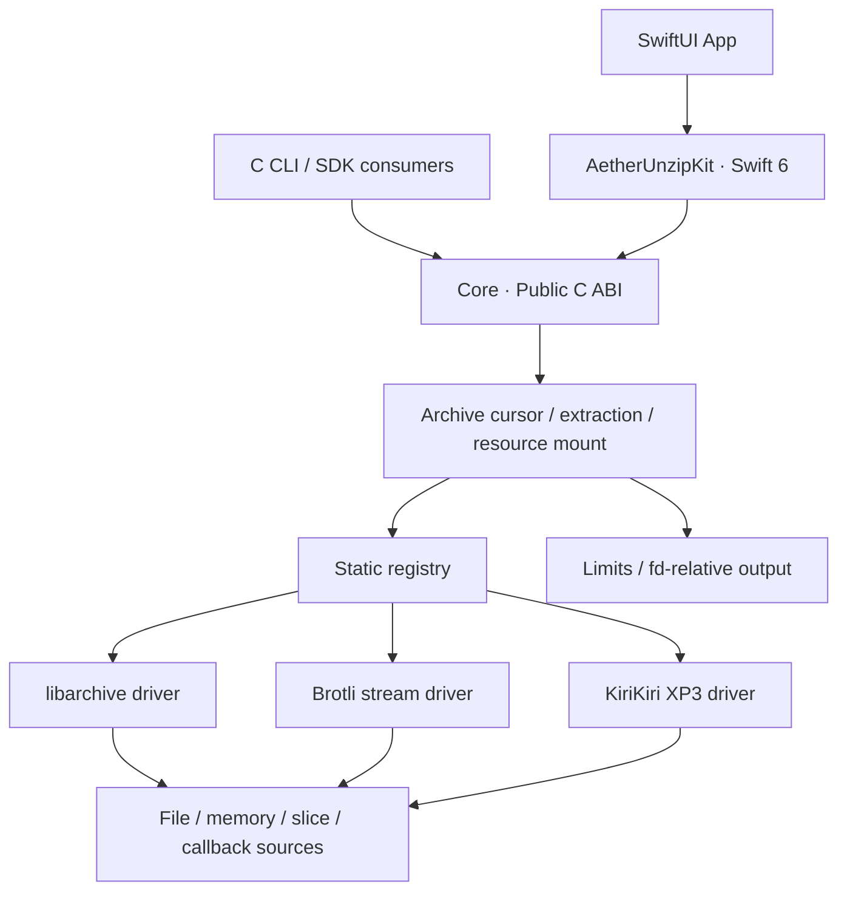

# 架构

- `apps/AetherUnzip` 承载 Apple 界面、最近记录和设置。App 通过 SDK 访问 Core。
- `bindings/swift` 管理 Security-Scoped URL、文件协调、错误映射和 Swift 任务。SDK 在后台同步作用域内管理 C 句柄，向 Swift 返回值类型和异步进度。
- `core/include/aetherunzip` 暴露 C17 可用的 ABI。Core 处理 I/O、驱动调度、归档游标、资源读取和提取策略。
- `modules/archive/libarchive` 将数据源和归档游标映射到 libarchive。第三方库的类型留在驱动实现中。
- `modules/codecs/brotli.c` 将单独的 Brotli 流表示为一个条目，沿用 Core 的读取和提取策略。
- `modules/game_formats/xp3` 处理 KiriKiri XP3 索引和文件分段，复用系统 zlib 及 Core 安全提取策略。

## 资源处理

数据源提供顺序读取、偏移读取、长度和能力查询。文件源以固定大小读缓冲区工作。内存源持有输入副本。切片源保持底层源的引用，可组合偏移窗口。拼接源为分片提供可跨边界读取的逻辑字节视图。回调源、sink 可接入自定义 I/O。驱动需要从 0 开始且长度已知的随机读取逻辑源。

当前管道由切片、格式识别、可选外层流解码和容器读取组成。归档句柄持有独立游标。资源挂载可枚举文件和目录的元数据。调用方可选建具有名称预算的路径索引，逐层枚举显式和隐式目录，并按 UTF-8 路径或条目编号打开独立游标。条目读取为顺序模式，调用者可利用文件长度能力预分配，打开条目可能从头扫描。

嵌套挂载把选中的条目以固定大小的数据块暂存为可随机读取的源，然后复用格式识别和资源挂载。各层沿祖先链收紧暂存容量与嵌套深度限制。

组合挂载为多个归档建立统一的路径索引。每个虚拟文件的索引指向底层归档及原始条目。读取复用原归档驱动，组合索引保存路径和元数据。

驱动通过静态注册表分派。未来的数据提供器和游戏格式作为独立实现接入，保持 C ABI 和上层调用关系。平台边界是 POSIX 文件 I/O 和提取目录操作。Windows 原生提取需要等效的句柄相对路径策略。
